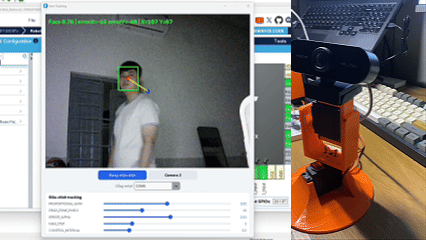
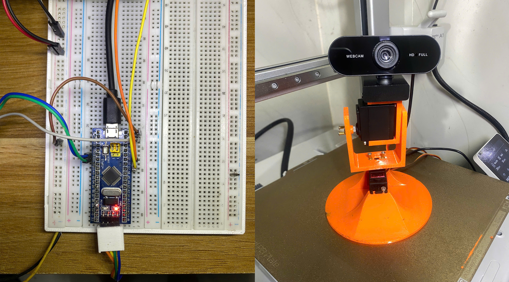

# Face Tracker - Thiết bị nhận diện và tracking khuân mặt 2 trục XY

Dự án sử dụng Python và YOLO để phát hiện khuôn mặt qua webcam. Từ vị trí khuôn mặt trong khung hình, chương trình tính toán góc quay và gửi lệnh qua UART đến STM32. Hai servo điều khiển camera theo phương ngang (X) và dọc (Y), giúp khuôn mặt luôn nằm giữa giữa khung hình. 

## 1. Phần cứng và kết nối

### Linh kiện sử dụng

- **STM32F103C8T6 (Blue Pill):** nhận lệnh từ máy tính, đọc joystick và tạo tín hiệu PWM điều khiển servo.
- **2 servo MG99R:** xoay camera theo hai trục X và Y.
- **Joystick hai trục:** dùng để điều khiển camera thủ công qua hai tín hiệu analog VRx và VRy.
- **Webcam USB:** cung cấp hình ảnh cho chương trình Python.
- **Máy tính:** chạy YOLO và gửi lệnh điều khiển đến STM32 qua USB–UART. Ưu tiên máy có GPU NVIDIA để tăng tốc xử lý.
- **Khung pan-tilt in 3D:** [Tham khảo mẫu STL trên MakerWorld](https://makerworld.com/en/models/973248-pan-tilt-servo-antenna-tracker-mg996r#profileId-945437).

### Bảng kết nối dự kiến

| Chức năng | Chân STM32 |
| --- | --- |
| PWM servo X | PA7 |
| PWM servo Y | PB1 |
| Joystick VRx | PA4 |
| Joystick VRy | PA5 |
| STM32 TX → USB–UART RX | PA9 |
| USB–UART TX → STM32 RX | PA10 |
| GND | Nối chung GND giữa các thiết bị |

**Lưu ý:** Các chân GPIO có thể thay đổi tùy vào config trong STM32CubeMX, không cố định như mô tả hehe. Nối chung GND với STM32. Joystick dùng nguồn 3,3V để tín hiệu analog nằm trong giới hạn ADC.

## 2. Chức năng chính

- Hiển thị hình ảnh camera cùng khung phát hiện khuôn mặt, độ tin cậy và độ lệch so với tâm ảnh.
- Tự động điều chỉnh hai servo để bám theo một khuôn mặt.
- Chọn cổng COM và chuyển đổi giữa camera có chỉ số `0` và `2`.
- Thay đổi hệ số điều khiển, vùng chết, hệ số lọc và bước thay đổi góc tối đa ngay trên giao diện.
- Ngừng gửi lệnh cập nhật góc bám khi không còn phát hiện được khuôn mặt.

## 3. Phát hiện và bám theo khuôn mặt bằng YOLO

Quá trình xử lý trên máy tính gồm các bước:

1. **Lấy hình ảnh:** đọc khung hình từ webcam và lật các frame bằng OpenCV để không bị ngược trục điều khiển.
2. **Phát hiện khuôn mặt:** sử dụng mô hình `models/yolov11n-face.pt`, kích thước đầu vào `416` và ngưỡng tin cậy `0,5`. Chương trình ưu tiên CUDA nếu có GPU NVIDIA hỗ trợ, nếu không sẽ chạy trên CPU.
3. **Chọn mục tiêu:** ban đầu chọn khuôn mặt có độ tin cậy cao nhất. Ở các khung hình tiếp theo, ưu tiên khuôn mặt gần vị trí mục tiêu trước đó. Nếu mất mục tiêu trong 5 khung hình, chương trình cho phép chọn lại.
4. **Tính góc điều khiển:** xác định độ lệch giữa tâm khuôn mặt và tâm khung hình theo từng trục. Độ lệch được làm mượt bằng bộ lọc trung bình mũ, sau đó đưa qua bộ điều khiển tỉ lệ để tính góc servo.

YOLO chỉ được sử dụng để **phát hiện vị trí khuôn mặt**, không nhận dạng danh tính người xuất hiện trong hình.

**Lưu ý:** Các thông số: PROPORTIONAL_GAIN, DEAD_ZONE_PIXELS, ERROR_ALPHA, MAX_STEP, CONTROL_INTERVAL cần hiệu chỉnh lại.

## 4. Điều khiển phía STM32

Phần dưới đây là logic dự kiến triển khai; hiện chưa có firmware STM32 trong tài liệu để kiểm chứng:

- **Chế độ tự động:** nhận lệnh UART ở tốc độ `115200 baud`, kiểm tra giá trị góc rồi cập nhật xung PWM cho servo tương ứng. Ví dụ: `90\n` đặt góc trục X là `90°`, còn `Y:90\n` đặt góc trục Y là `90°`.
- **Chế độ thủ công:** đọc ADC từ hai trục joystick, áp dụng vùng chết quanh vị trí trung tâm và chuyển độ lệch thành thay đổi góc servo.
- **Chuyển chế độ:** firmware cần quy định cách chuyển giữa điều khiển bằng joystick và bằng UART, tránh hai nguồn lệnh cùng tác động đến servo.

## 5. Hình ảnh và video demo

### Demo hệ thống

### Mạch điều khiển và khung camera

## 6. Lưu ý về bản quyền
- **Dự án được thực hiện nhằm mục đích học tập và nghiên cứu, không sử dụng cho mục đích thương mại. Quyền sở hữu và điều khoản cấp phép của các thư viện, mô hình và tài nguyên bên thứ ba vẫn thuộc về tác giả hoặc đơn vị cung cấp tương ứng.**
